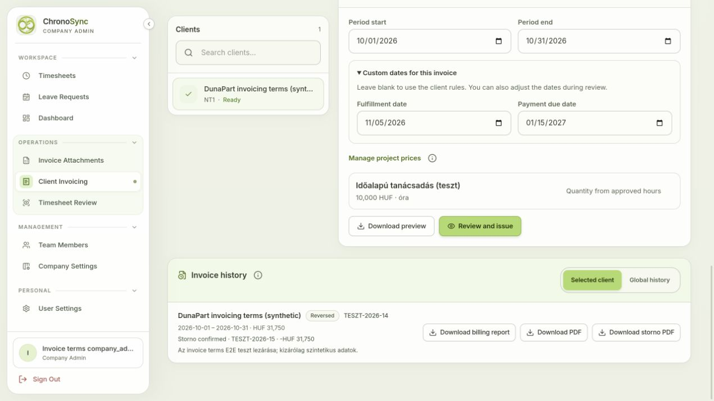

# Invoice terms E2E — 10 November 2026

All **54 checks passed**. See [machine-readable results](results.json) and
[provider confirmation](provider-confirmation.json).

The updated local frontend and backend used hosted Supabase with migration
`20261110115432_client_invoice_terms`, actual authenticated tenant roles, and the
dedicated **Teszt cég** provider. No transport mocks were used in this run. The
user confirmed visible TESZTÜZEM before issuance, and the returned XML contains
`teszt=true`. This is a local application E2E check, not a deployed-app check.

An isolated synthetic tenant, **Test Inc invoice terms staging 2026-11-10**
(`aecc1a65-66a8-42ed-a44f-baed35fdfcbe`), preserved the existing mock company's
provider credentials and all prior data. The original 100 billing profiles,
company rows and 22 invoice ledger records have unchanged hashes after testing.

## Documents and browser evidence

- [Issued test invoice TESZT-2026-14](issued.pdf): 2.5 approved hours at 10,000 HUF;
  net 25,000, VAT 6,750, gross 31,750 HUF. Fulfillment 2026-11-05, deadline
  2027-01-15. The multiline Hungarian note and PO reference match the review.
- [Provider preview downloaded from the browser review](browser-preview.pdf).
- [Archived timesheet annex](archived-annex.xlsx): byte-identical to the reviewed
  annex, SHA-256 `461cc007c34eeaec69c68765fbbeb9cbae672b3854e32fbd95ab0d1d7efafc3e`.
- [Storno TESZT-2026-15](storno.pdf), explicitly approved by the user, links to
  TESZT-2026-14 and reverses its amounts. The original PDF remains unchanged;
  approved work is restored. Draft, submitted and rejected work is untouched.
- [Reviewed dates and note](browser-review.png), [successful browser issuance](browser-issued.png),
  and [confirmed storno in history](browser-storno.png).

All PDF pages were rendered and visually inspected. The provider XML, rendered
documents and ledger snapshot agree with the confirmed review. The focused local
invoice terms/API validation suite passed **36 tests** in the same session.

## Protection and cleanup

Checks include saved default compatibility, calendar reference rules, manual date
bounds and strict input types, hosted note constraints, stale review protection
for preview/attachment/issuance, fresh UI confirmation, duplicate protection,
regular-user and cross-tenant denial, immutable archives, and cancellation.

No customer email was requested. Temporary users are banned with empty passwords
and no sessions. The staging key was removed from the isolated company, its
application preview gate restored, and the company disabled. Temporary local
secret files were removed and both local servers stopped. The test audit records
and documents remain preserved. There are no unsettled invoices and no new
security advisor findings. Application deployment is still a separate step.

